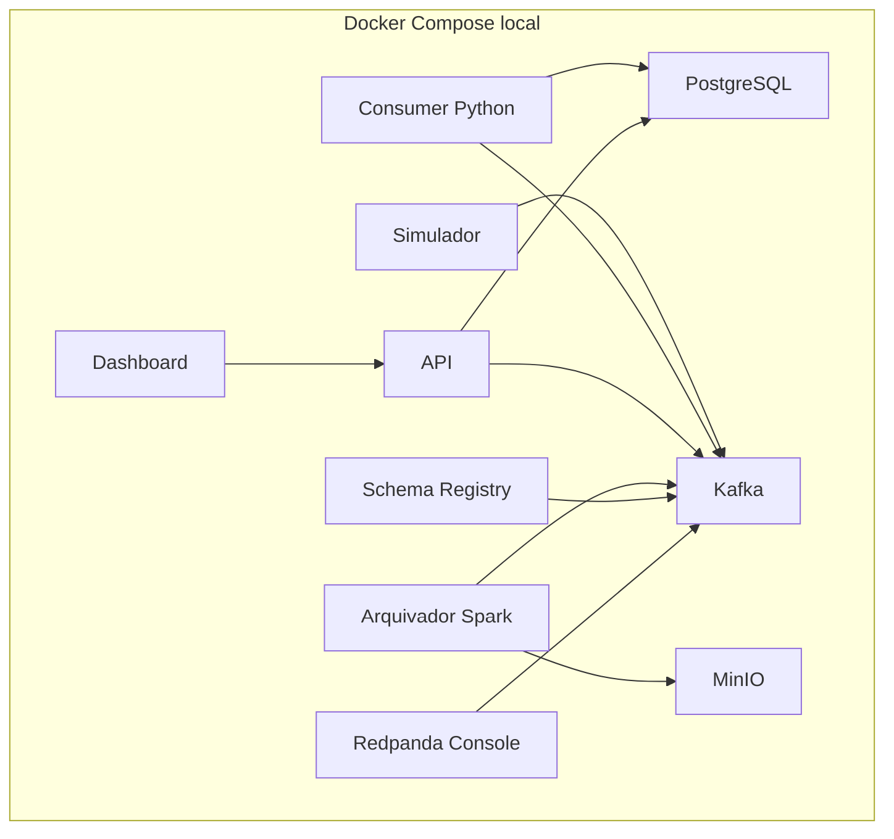

# Execução local com Docker Compose

## Execução local

O RaceStream é executado como laboratório de estudo e teste em uma máquina
local. Docker Compose reúne os serviços; este repositório não publica imagens,
não executa deploy e não mantém um workflow CI ativo.

## Health checks e reinício

- PostgreSQL, MinIO, Kafka, Schema Registry e API têm health checks.
- simulator, consumer, API, dashboard e Spark usam `restart: unless-stopped`.
- Redpanda Console também reinicia, mas não tem health check.
- dashboard, simulator, consumer e Spark não têm health checks próprios.
- `topic-init` e `minio-init` devem terminar com sucesso.

## Persistência no deploy local

Os volumes nomeados são `kafka-data`, `postgres-data`, `minio-data` e
`spark-work`. `docker compose down` preserva os volumes; `down -v` os remove.

## Arquivos fora do escopo local

Há arquivos históricos de composição e configuração voltados a outros cenários.
Eles não são usados pelos comandos, testes ou fluxos documentados para este
laboratório e não representam um plano de publicação. A execução suportada usa
`docker-compose.yml` e os overlays descritos em [operação local](operacao-local.md).

## Kubernetes e Helm

> Não identificado no repositório.

Não existem manifests, charts, probes Kubernetes, requests/limits de cluster,
ConfigMaps ou Secrets.

## CI e deploy

Não há CI ou deploy configurado no repositório compartilhado. O arquivo local
`.github/workflows/ci.yml` é ignorado pelo Git. As verificações são executadas
manualmente conforme [testes](testing.md); não publique este laboratório como
ambiente de serviço.

## Deploy em nuvem

> Não identificado no repositório.

O uso de S3A aponta para o MinIO local. Não há módulos Terraform, Pulumi,
CloudFormation, Ansible ou configuração de AWS, Azure ou GCP no repositório.

## Unidades systemd auxiliares

`integrations/systemd/` contém automações específicas da estação local. Elas não
fazem parte do deploy dos serviços RaceStream nem são iniciadas pelo Compose.
