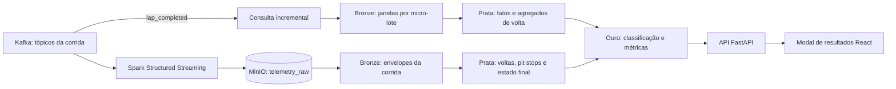

# ExecPlan — Camadas medalhão por corrida

## 1. Objetivo

Materializar no MinIO os eventos já arquivados pelo Spark em bronze, dados
normalizados em prata e uma classificação ouro para o dashboard. Ao detectar o
fim da corrida, a tela apresenta essa classificação em uma janela de resultados.

## 2. Escopo

Inclui somente execução local via Docker Compose, transformações batch Spark,
leitura do resultado ouro pela API e modal React. O workflow GitHub Actions fica
local e ignorado pelo Git; não haverá publicação ou deploy.

## 3. Estado atual

O serviço `spark-archive` grava envelopes Avro em `telemetry_raw` e mantém uma
segunda consulta Structured Streaming para persistir `lap_completed` por
micro-lote em Bronze e Prata. Ao final, Ouro usa esses agregados quando cobrem
`laps_completed` de todos os carros; se não cobrirem, o materializador usa as
voltas arquivadas como fallback batch. A API e o dashboard exibem o resumo final.

## 4. Arquitetura alvo

## 5. Contratos

- Prefixo por corrida: `corridas/{race_id}/bronze`, `prata` e `ouro`.
- Ouro: posição, carro, piloto, país, melhores/piores/médias de voltas, pit stops
  concluídos e medalha do pódio.
- API: `GET /api/races/{race_id}/medalhao`, com `404` enquanto o resultado não
  estiver materializado.
- O término é identificado pelo evento `control` com `status=finished`.

## 6. Etapas

- [x] Implementar a transformação idempotente dos envelopes arquivados em
  camadas por corrida.
- [x] Expor a classificação ouro pela API e mostrar a janela após o término.
- [x] Testar agregações, contagem de pit stops e leitura da API.
- [x] Atualizar instruções do laboratório e ignorar o workflow GitHub local.
- [x] Executar as fixtures Spark e testar leitura/escrita real no MinIO com dados
  de uma corrida já arquivada.
- [x] Persistir janelas de voltas em Bronze/Prata durante a prova e usar os
  agregados na Ouro quando a cobertura coincidir com o quadro final.
- [x] Manter fallback batch quando o stream incremental ainda estiver atrasado.

## 7. Estratégia de testes

Fixtures Spark sem dependências externas validam deduplicação, voltas válidas,
consolidação de múltiplas janelas, paradas concluídas, pódio e ordenação. Testes FastAPI usam um adaptador falso;
testes frontend validam formatação e apresentação da classificação.

## 8. Riscos e decisões

- O histórico bruto continua em `telemetry_raw`; bronze é uma cópia particionada
  por corrida e mantém os envelopes originais para consulta independente.
- O incremental cobre somente `lap_completed`; pit stops, quadro final e Bronze
  completo continuam sendo consolidados depois da bandeirada.
- A cobertura é conferida usando `laps_completed` por carro; se divergir, o
  processamento final relê o arquivo bruto para preservar a correção.
- A transformação roda no processo Spark de arquivamento, sem um segundo driver
  Spark residente no laboratório.
- A janela usa um fundo externo com 50% de opacidade e painel interno opaco para
  conservar o contraste do texto.
- Resultado ouro ausente após falha de transformação é reprocessado na próxima
  varredura; cada camada da corrida usa gravação `overwrite` idempotente.
